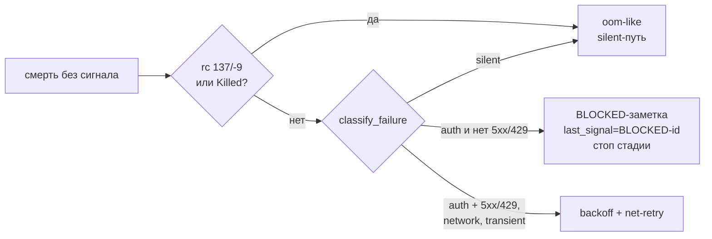

# Архитектура: carry batch C+D — диагностика, документация, паритет и approve-bind

Статус: REVIEW
Ревизия: arch-5
Входы: `carry-cd.md@req-7` (PASS `review-7`); `carry-cd.requirements-review.md@review-7`; `carry-cd.context.md@ctx-3`; TODO-0279; TODO-0266
База кода: HEAD `13fb5e4` + WIP TODO-0276 в рабочем дереве; пакет `docs/spec/carry-cd/` untracked
Основание: проверка по коду на этом дереве; runtime не запускал — реальные строки провайдера взяты из ctx-3 §0.1 и DONE-TODO-0276.

## 1. Границы и точки изменения

| Компонент | Ответственность | Файл | R# |
|---|---|---|---|
| Диагностика смерти | ленивый хвост, один текст сигнала, класс отказа | `awf/_worker_exit.py`, `awf/agent_stage.py`, `awf/signal_watch.py` | R1 |
| Классификатор сбоя | сеть / авторизация / transient / silent, BLOCKED-заметка | `awf/_net.py`, `awf/pipeline_engine.py` | R12 |
| Артефакт сьюта | распознавание полного прогона, артефакт, факт в handoff | новый `awf/suite_guard.py`, `awf/agent_stage.py`, `awf/unit_contract.py` | R13 |
| Команда сьюта | одна сборка канонической команды | новый `awf/suite_command.py`, `awf/cli.py`, `scripts/suite-canonical.sh` | R13 |
| Архив | POSIX-барьер до перемещения | `awf/todos.py` | R2 |
| Managed-барьеры | approve-сигнал, черновик TODO, запись конфига | `awf/api/pipeline.py`, `awf/todo_draft.py`, `awf/api/setup.py` | R9, R6, R10 |
| Записи нарушения | corrupt-запись = открытый коммит | `awf/stage_manifest.py` | R11 |
| Разбор текста TODO | тривия и фенсы | `awf/_markdown.py`, `awf/unit_contract.py`, `awf/commit_gate.py` | R5 |
| Классификация метрик | относительный `project_dir` | `awf/metrics.py` | R7 |
| Паритет CLI | текст, флаги, rc | `awf/cmd_pipeline_write.py`, `awf/cmd_dispatch.py`, `awf/cli.py` | R8, R6 |
| Документация | README, `design.md`, USAGE, практики, заметки | `README.md`, `docs/`, `USAGE*.md` | R3, R4 |

## 2. Контракты

**K1 — ленивый хвост.** `worker_exit_line(rc, duration_sec, tail_fn=None, *, signal_present, cls=None)` вместо готовой строки: при `signal_present=True` возвращает `""`, не вызывая `tail_fn`. Вызывающий в `agent_stage.py:271` передаёт `lambda: worker_log_tail(log_holder)`; путь таймаута (`signal_watch.py:81`) хвост не читает и передаёт только `cls="timeout"`. Текст «сигнал на диске» — один помощник `signal_present_line(name)` → `U6b: signal present (<name>)`; его зовут оба места, безымянной строки `BD-20: signal already detected` не остаётся. Имя в `signal_watch.py` берётся из `signal_holder`, иначе перечитывается сигнал, иначе `unknown`. `read_log_tail` уже читает 64 КиБ от `start_offset` и даёт `""` на пустом/отсутствующем пути — только докстринг.

**K2 — архив.** Первым действием `archive_todo` идёт `managed_fs.require_posix("archive todo")` в том же `try`, что и `assert_no_symlink_escape`; `ManagedPathError` переводится в `OSError(f"archive {todo_id} refused: …")` — семейство, которое ждут вызывающие (`todos.py:228-231`). На POSIX порядок и четыре поверхности не меняются; no-follow preflight остаётся.

**K3 — платформа.** README: не-POSIX — неподдерживаемая платформа, запуск и разрушение отказывают. `_lock.py`: msvcrt — живая ветка прямых `locked()`, мёртвый резерв в fail-closed записи состояния. `design.md` держит то же разделение, не упоминает `_transact.py`, ссылается на инвентарь `docs/design/agentic-writers.md`.

**K4 — документация.** Пять текстовых правок: обещание симлинка `templates/` из `practices.md` убрано; оба USAGE знают код 5 и `AWF_SUITE_CMD`/`AWF_PYTHON`; докстринг `add_role` перечисляет пять шаблонов; докстринг `awf_templates_dir` описывает канонический строитель, не «все копии»; `RELEASE-NOTES.md` говорит 1→2 для `retry.silent_work_attempts`. Поведение не меняется.

**K5 — тривия и фенсы.** Новый `_markdown.skip_comments_and_blanks(lines) -> int`: пропускает пустые строки и завершённые `<!-- … -->` любой длины, останавливается на первой другой строке, включая `---`. `_find_contract_block` берёт его вместо построчного `startswith("<!--")`; послабление «заголовок перед блоком» сохраняется. `_todo_title` заменяет построчный regex на `skip_leading_trivia` + `first_heading_index(level=1)`: фенс уже пропускается флагами, незакрытый фенс/комментарий дают legacy subject. Ошибка незакрытого `---` получает имя файла у вызывающего. Незакрытый комментарий — «контракта нет, ошибки нет».

**K6 — черновик и диспатч.** `todo_draft --out` проверяет принадлежность `.agentic` явно (общий `refuse_unsafe_surfaces` этого не делает): `agentic = paths.agentic_dir(project_dir)`, лексическая проверка `normpath(out).is_relative_to(normpath(agentic))` плюс `assert_no_symlink_escape(out, root=agentic)` — до `managed_mkdir(out.parent, root=agentic)` и `managed_write_text(out, draft, root=agentic)`. Симлинк или путь вне `.agentic` отказывает без файлов и родителей (D2). `blocked_draft` ищет канонический `BLOCKED-<id>.md`, затем legacy `BLOCKED-<short>.md` через `signals.short_id`; нет обоих — ошибка называет оба пути. Относительный `--content-file` резолвится от `project_dir`. CLI получает `--allow-mismatch` (`store_true`), `--carry-over-from TODO-NNNN`, `--include-untracked` (`action="append"`) и передаёт их в `dispatch_todo`.

**K7 — метрики.** `_write_cache_managed` переводит к абсолютному `project_dir` без раскрытия симлинков (`os.path.abspath`), лист остаётся на `os.path.normpath`; сравнение — лексическое `is_relative_to`. Внутри проекта — `managed_write_text(root=project_dir)` без предупреждения; снаружи — `mkdir` родителей, предупреждение с путём и `root=path.parent`, как сейчас (D8). Отчёт по умолчанию — на рабочий стол.

**K8 — вариант пайплайна.** Общий строитель `_variant_composition(variant)` и текст `pipeline_variant_yaml_text`; CLI и форма берут их. CLI (`write_variant_pipeline`) пишет только файл, роли не материализует; форма (`write_pipeline(flow_variant=…)`) дополнительно зовёт `_materialize_variant_roles` и пишет `models.<role>`. `--help` и успешный вывод называют разницу и маршрут `awf add-role <slug>` / форма; непереведённые роли — WARNING. rc: файл записан — 0; ошибка записи или занятое имя без `--force` — 1; неизвестный `--variant` — 2 (`choices`, D3).

**K9 — approve-бинд.** Порядок (R9, FR9): preflight → `RUN-EVIDENCE` → `VERIFIED-<id>.sha` → `managed_mkdir(inbox)` → сигнал.
1. На входе stale `CANDIDATE-<todo>.json` только удаляется (`_discard_candidate_evidence`); свой preflight по `context`/листу остаётся. Новых файлов нет — состав каталогов после отказа не меняется. Read-only проверки до первой записи: формат и совпадение `verified_sha`, требование `evidence` в забеге.
2. Первый эффект — `refuse_unsafe_surfaces(project_dir, "approve", inbox, signal)` (POSIX + no-follow, до записей и `managed_mkdir`). Симлинк `inbox` или симлинк-лист `APPROVE-<id>.ready` отказывает без `RUN-EVIDENCE`, `VERIFIED` и сигнала.
3. Запись `RUN-EVIDENCE` (`managed_write_api_text` держит no-follow по `context`) → `VERIFIED` тем же барьером → `managed_mkdir(inbox)` → сигнал.
Отпечаток пишется до сигнала: гейт, увидевший сигнал, обязан увидеть отпечаток (атомарная замена). Сигнал — no-follow: `os.replace` заменяет лист, не цель симлинка. Отказ preflight не откатывает существующий отпечаток и не создаёт сигнал. В забеге сигнал несёт `generation`, `verified_sha`, `files_digest`, `evidence_digest` (`binding_projection`), вне забега — пустой маркер. Подмена листа на обычный файл вне scope (D4).

**K10 — запись конфига.** Новый `awf/config_write.py::patch_mapping(text, updates) -> str` без новых зависимостей (D5): построчный патч блока `models:`, меняются только скалярные строки `agent_name`/`model` нужной роли, недостающие ключи вставляются, лишний `model` удаляется; комментарии, пустые строки и порядок вне правки не трогаются. Результат проверяется `yaml.safe_load` и сравнением с целевым словарём; расхождение, flow-стиль `models:` или нестандартный отступ — отказ без перезаписи. `.bak` и timestamped-копии остаются; битый YAML отклоняется до записи.

**K11 — запись нарушения.** `_open_path_names` возвращает `(names, corrupt)`: не-dict `paths` — corrupt и синтетическое имя `<paths: invalid>`; запись без строкового `after` держит путь. `_still_rejected_paths` для corrupt пишет `{"<paths: invalid>": {"before": "<missing>", "after": None}}`, поэтому слияние не теряет повреждение. `open_violations` различает «ключа нет/пусто» (исчерпана) и corrupt (открыта). `OpenViolation.reason()` печатает синтетическое имя и файл записи.

**K12 — класс сбоя и BLOCKED.** `_net.classify_failure(text, rc=None) -> "network" | "auth" | "transient" | ""`. Порядок: OOM → D6 → auth → сеть.
1. **OOM первым.** `is_oom_exit(rc, text)` (rc 137/-9 или `Killed`) → `""`: за процесс текст не говорит, `classify_worker_exit` даёт `oom-like`. OOM старше auth и 5xx (F6).
2. **Контекст провайдера — на строке:** `AI_APICallError` или `error.error=`. Он отличает отказ провайдера от текста проекта.
3. **Auth.** В контексте — `401`/`403` статус-токеном ИЛИ фраза про credential/ключ/unauthorized/forbidden. Вне контекста — статус-токен И фраза на одной строке; токен — ключ `HTTP`/`statusCode`/`status`/`code`/`error` (кавычка допустима: `"code": 401`) или код в начале строки (`401 Invalid credential`). `test_401_credential_expiry` и `assert 401 == 200` — не токен; `GET /login -> HTTP 401` без фразы — не auth.
4. **Сеть — закрытый список:** connect/reset/timeout, `Endpoint is unavailable`, `All workers are unavailable`, `admission slot`, `cell is at capacity` → `network`; код `429`/`5xx` в HTTP/status/code-контексте или с фразой (`500 Internal Server Error`, `Service Unavailable`, `Too Many Requests`), `overloaded` → `transient` (тот же ретрай). `upstream request failed` — не сеть; `[unsupported_request]`, `Bad Request` — `silent`; число без контекста (`1500 passed`, `took 429ms`) — `silent`.
5. **D6.** Auth и 5xx/429 в одном хвосте → `network`, иначе auth старше сети.
`is_network_failure` = класс в `{network, transient}`; `classify_worker_exit` делегирует сюда и печатает `transient` как `network` — диагностика и решение движка совпадают (INV6). Обе ветки смерти (`_handle_net_death` для retry, `_stop_on_auth_failure` для `auth`) читают один классификатор. BLOCKED-путь: `_write_blocked_signal_note` — общий писатель со `_write_blocked_violation_note`, схема `docs/unit-contract.md`, файл `outbox/BLOCKED-<id>.md`, затем `write_state(last_signal=f"BLOCKED-{id}")` и выход без повторного спавна. Окно проверки «второго `awf run`» — лог воркера от `log_start_offset` попытки (RR23).

**K13 — артефакт сьюта.** Проверка идёт после выхода воркера и до `collect_handoff` (`agent_stage.py:294`) по финальному дереву.
1. Источник — лог воркера: `log_holder["log_path"]` от `log_start_offset` до конца (новый `_net.read_log_from`; `read_log_tail` теряет начало лога).
2. Полный сьют распознаётся как `scripts/run-all.sh` или `pytest` с целью ровно `tests`/`tests/` (опции до и после допустимы); `pytest tests/unit/…` и `-k` — не полный сьют.
3. `sha = git_utils.tree_fingerprint(project_dir)` (та же функция, что у `awf tree-sha`), каноническая команда — из K14; ищем `context/SUITE-<sha>-*.json` с точным равенством `command` канонической строке.
4. Артефакт найден — тишина. Нет — `SUITE-WARN: …` в stage-log и факт строкой в handoff: `collect_handoff(..., engine_facts=["suite_gate=raw-full-suite"])` добавляет пункт в «Engine facts». DONE.json воркера не переписывается (D7). Стадия не блокируется, коммит не блокируется.
`.agentic/context/` исключён из отпечатка (`.git/info/exclude`), поэтому поздняя проверка видит тот же `sha`.

**K14 — одна сборка команды сьюта.** Новый `awf/suite_command.py`: `resolve(project_dir) -> SuiteCommand | None`, где `SuiteCommand(command: str, source: "config"|"legacy")`.
- `verification.test_cmd` — непустая строка → `source="config"`, команда как записана;
- ключа нет → `source="legacy"`, `f"{pybin} -m pytest tests/ -q -n auto --timeout=300 -p no:cacheprovider"`, `pybin = os.environ.get("AWF_PYTHON") or "python3"`;
- `null`, пустая строка, битый YAML → `None` («сьют не настроен»).
`AWF_SUITE_CMD` резолвер не читает: оболочку переопределяет только скрипт, а движок такой артефакт каноническим не считает (AC34). CLI `awf suite-command` печатает команду и отдаёт rc 0 (config), 1 (legacy), 2 (не настроен). `scripts/suite-canonical.sh` заменяет свой блок сборки на `cmd=$(run_awf suite-command)` с разбором rc — литерал pytest остаётся в одном месте. Движок и скрипт получают одинаковую строку при одном `AWF_PYTHON` (воркер наследует env движка, `_env.awf_subprocess_env` копирует `os.environ`).

## 3. Состояния, отказы и совместимость

Отказы до первого эффекта (INV1): K2 — до перемещения; K6 — до `mkdir` и `<out>`; K9 — до записи `RUN-EVIDENCE`, `VERIFIED` и сигнала (stale `CANDIDATE-<todo>.json` только удаляется и новых файлов не создаёт); K10 — до перезаписи конфига. Во всех случаях ни файла, ни каталога, ни `.ready`, ни baseline.

Совместимость: внешний кэш метрик и отчёт сохраняются; `pipeline-write` роли не материализует; `todo-draft --out` вне `.agentic` теперь отказывает (R6). Handoff получает «Engine facts», старые читатели её игнорируют; `DONE.json` не меняется, новых зависимостей нет.

## 4. Решения

D1 — R4 только текст: перевод трёх модулей на `awf_templates_dir` расширяет scope и нарушает AC11, пользы не даёт.
D2 — ядро (`todo_draft`) использует `managed_fs`, а не `api/_helpers`: импорт api из ядра переворачивает слои.
D3 — `choices` остаётся: неизвестный `--variant` — rc 2, конвенция argparse.
D4 — K9 закрывает симлинк; подмена на обычный файл вне scope (dirfd/openat).
D5 — R10 без `ruamel`: пакета нет, свой патчер с проверкой через PyYAML дешевле зависимости, fail-closed покрывает нестандартный стиль.
D6 — auth старше сети (R12); исключение — 5xx/429 в том же хвосте: перегрузка, а не мёртвый ключ. «Рядом» = весь хвост (D12).
D7 — факт K13 пишет движок строкой handoff, не в `DONE.json`: файл принадлежит воркеру, а ручной прогон снаружи движка невидим.
D8 — `agentic_root_for` для R7 не годится: для пути вне `.agentic` он вернёт родителя листа и ослабит барьер; корень — абсолютный `project_dir`.
D9 — команду сьюта собирает Python-резолвер, скрипт спрашивает его через CLI: копии литерала разошлись бы по `AWF_PYTHON` (RR24).
D10 — preflight approve идёт до `RUN-EVIDENCE`/`VERIFIED`: AC24 и INV1 обещают отказ без файлов, а отпечаток откатывать нельзя. Обратный порядок требовал бы переписать INV1/§3.
D11 — OOM вне текста: rc 137/-9 и `Killed` значат, что процесс умер до чтения ключа, поэтому `classify_failure` при OOM даёт `""`, а класс `oom-like` ставит `classify_worker_exit`. WIP 0276 защищал OOM только от auth — `rc=137` с `HTTP 500` оставался network (F6).
D12 — близость D6 — весь хвост лога, не строка: так устроен `classify_failure(text)` и так закрепляет T2; RR30 (MINOR, req-8) формулировку не меняет. Выбор «на одной строке» меняет один предикат, не контракт.

## 5. План

**IMP1 — диагностика: R1, R12.** `_worker_exit.py`, `agent_stage.py`, `signal_watch.py`, `_net.py`, `pipeline_engine.py`. Тесты: `tests/unit/test_worker_exit.py`, `tests/negative/test_worker_failure_matrix.py`, `tests/negative/test_carry_diag.py` (ленивый хвост, классы, BLOCKED-заметка, окно метки). Строки WIP 0276 в `test_carry_diag.py` закрепляют старое правило — IMP1 их переворачивает: `statusCode: 401` → auth, `Upstream request failed` → silent, `Endpoint is unavailable` → network, `rc=137` + `HTTP 500` → `oom-like`; негативы AC32 остаются.
Результат: одна строка смерти, классы R12, BLOCKED без второго спавна; правило K12 применяется к 0276.

**IMP2 — артефакт сьюта: R13.** `suite_guard.py`, `suite_command.py`, `cli.py` (`suite-command`), `scripts/suite-canonical.sh`, `agent_stage.py`, `unit_contract.py` (`collect_handoff(engine_facts=…)`), `docs/unit-contract.md`. Тесты: `tests/unit/test_suite_command.py` (config/legacy/нет ключа, `AWF_PYTHON`), `tests/negative/test_carry_suite_gate.py` (сырой прогон, артефакт, чужой `AWF_SUITE_CMD`, чужое дерево), `tests/unit/test_unit_contract.py`.
Результат: обход виден фактом, канон не блокируется.

**IMP3 — барьеры: R2, R9, R11.** `todos.py`, `api/pipeline.py`, `stage_manifest.py`. Тесты: `tests/negative/test_approve_binding.py`, `tests/unit/test_commit_gate.py`, новый `tests/negative/test_carry_barriers.py` (не-POSIX архив, симлинк inbox и листа сигнала, corrupt `paths`).
Порядок approve — preflight → `RUN-EVIDENCE` → `VERIFIED` → `managed_mkdir` → сигнал (K9, D10); отказ по симлинку оставляет каталоги без новых файлов.

**IMP4 — пути и текст: R5, R6, R7.** `_markdown.py`, `unit_contract.py`, `commit_gate.py`, `todo_draft.py`, `api/hygiene.py`, `cmd_dispatch.py`, `cli.py`, `metrics.py`. Тесты: `tests/unit/test_unit_contract.py`, `tests/unit/test_commit_gate.py`, `tests/unit/test_todo_draft.py`, `tests/unit/test_metrics.py`, новый `tests/negative/test_carry_paths.py`.

**IMP5 — паритет и доки: R3, R4, R8.** `cmd_pipeline_write.py`, `cli.py`, `README.md`, `docs/design.md`, `docs/practices.md`, `USAGE.md`, `USAGE.ru.md`, `docs/RELEASE-NOTES.md`, докстринги `api/roles.py`, `api/_templates.py`. Тесты: `tests/negative/test_reports33_setup_form.py`, `tests/unit/test_carry_docs.py` (текст). Поведение не меняется.

**IMP6 — конфиг: R10.** `api/setup.py`, новые `config_write.py` и `tests/unit/test_config_write.py` (комментарии, порядок, идемпотентность, битый YAML, flow-отказ), `tests/unit/test_api_setup.py`.
Зависит от IMP3: обе правки пишут под `.agentic`.

Покрытие: R1→K1, R2→K2, R3→K3, R4→K4, R5→K5, R6→K6/D2, R7→K7/D8, R8→K8/D3, R9→K9/D4, R10→K10/D5, R11→K11, R12→K12/D6/D11/D12, R13→K13/K14/D7/D9. INV1 — IMP3, INV2 — IMP3, INV3 — IMP5, INV4 — IMP3, INV5 — регрессия канареек, INV6 — IMP1, INV7 — IMP4.

## 6. Допущения и вопросы

A-env — движок и скрипт видят один `AWF_PYTHON`; иначе предупреждение останется. Проверяется IMP2.
A-RR30 — «рядом» в D6 = один хвост лога (D12); если req-8 выберет строку, меняется только предикат `has_transient`, T2 и класс BLOCKED остаются.
A-RR25 — fixture регрессии R5 — копия текста в тест-спеке, не путь к живому TODO.

Q1 — `BACKLOG-NEXT.md` вне репозитория: нужен путь или вклейка S5/P7/P8 (ответ не требуется для R1-R13).
