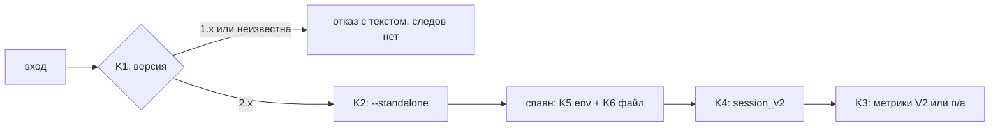

# Архитектура: awf 3.0 — только opencode 2.x

Статус: REVIEW
Ревизия: arch-2
Входы: opencode2-only.md@req-3; opencode2-only.requirements-review.md@reqrev-3; opencode2-only.context.md@ctx-1
База кода: 0384ba35ffc97ce370e6dc94bee098277d775860

## Изменения в arch-2

FR1 → K6, D5 (бэкап только при существующем файле); FR2 → K6, K8 (`model` строкой — валидный V2, из V1-ключей убран); FR3 → K2 (`opencode models` подчиняется managed); FR8 → K10 (`model_check` назван, G2 с исключением по объявленному списку V1-ключей); RR21 → K6, K8 (один перечень V1-ключей на пакет); FR9 → K6 (`external_directory` подчинён порядку правил). K1, K3, K4, K5, K7, K9, K11, K12, D1–D4, D6–D8 и IMP1–IMP6 по существу не менялись.

## 1. Рамка

Требования req-3 приняты (PASS reqrev-3); база — commit 0384ba3. Задача архитектуры — свести переходный слой 2.3.0 к одной форме на каждом слое запуска, данных и конфига, не трогая kill-группы, lease, state-store и модели ролей. Q1–Q3 закрыты фактами (D1–D3), подробности — в `ctx-1`:

- Q1: `OPENCODE_CONFIG_CONTENT` применяется — `Config.load` ставит env после глобального и проектного конфигов, перед `/etc/opencode`.
- Q2: маркеры сети — поимённо в K9.
- Q3: `permissions` — упорядоченный список `{action, resource, effect}`, побеждает последнее совпадение; действия 2.x — `shell`, `edit`, `subagent`, MCP-инструмент `<server>_<tool>`.

## 2. Границы и точки изменения

| Компонент | Ответственность | Файл (символ) | R# |
|---|---|---|---|
| Версия и preflight | отказ до первого эффекта, кэш на процесс | `awf/opencode_version.py` (`probe_version`, `gate`, `launch_plan`); `awf/api/pipeline.py::_opencode_gate`; `awf/api/run.py::_opencode_gate` | R1 |
| argv | `--standalone` всегда, кроме managed | `awf/opencode_version.py` (`resolve_standalone`, `apply_standalone`); `awf/agent_stage.py`; `awf/supervisor.py`; `awf/opencode_db.py::available_models` | R2 |
| Схема базы | единственный ридер V2, `n/a` с причиной | `awf/opencode_db.py`; `awf/metrics.py`; `awf/session_store.py`; `awf/api/model_check.py`; `agent_workflow_ui/src/agent_workflow_ui/opencode_config.py` | R3 |
| baseURL | один резолвер, одна форма | `awf/_net.py` (`model_endpoint_url`, `_base_url`) | R4 |
| env воркера | V2-payload, порядок правил | `awf/_env.py` (`awf_subprocess_env`, `merge_tool_profile`, `control_tool_permission_keys`) | R5 |
| файл агентов | два писателя, V2-форма | `awf/opencode_agents.py` (`propose`, `apply`, `_ensure_worker_permission`, `ensure_mcp_block`); `awf/cmd_init.py` | R5 |
| `awf doctor` | формат конфига, мёртвые ключи | `awf/doctor.py` (`_check_opencode` + новая `_check_config_format`); `awf/config_keys.py` (`READ_KEYS`, новый `V1_KEYS`) | R6 |
| маркеры сети | только строки 2.x | `awf/_net.py::NETWORK_MARKERS` | R7 |
| чистка | удаление мёртвого кода | `awf/opencode_version.py`, `awf/metrics.py`, `awf/opencode_db.py`, `awf/_env.py`, `awf/_net.py` (остатки) | R8 |
| страж | тест от возврата 1.x | `tests/unit/test_opencode2_only_guard.py` (новый) | R10 |
| доки | «requires opencode 2.x» | `README.md`, `USAGE.md`, `CHANGELOG.md`, `docs/design.md`, `docs/design/opencode-v2-migration.md`, `docs/spec/opencode2/assets/historical.md` (новый) | R9 |
| версия | 3.0.0 и `awf --version` | `awf/__init__.py`, `pyproject.toml`, `CHANGELOG.md`, `awf/cli.py` | R12 |
| конфиг владельца | ручной перевод в V2 | `opencode_config_file()` (`~/.config/opencode/opencode.json`) | R11 |

Новых сервисов, очередей и слоёв нет: все точки — существующие модули с суженной ответственностью. `awf/opencode_db.py` остаётся единственным владельцем решения «есть ли V2-схема»; CLI и плагин читают через него.



## 3. Контракты

### K1 — отказ по версии

`probe_version()` возвращает `Probe(status: ok|missing|unknown, version)`, кэш на процесс. `gate(project_dir)` → `(message, rc, warning)`; пустой `message` — запуск разрешён. Вызывается до TODO, baseline, `.ready`, `current`, dispatch, lease и PID (INV2).

| Условие | `message` (содержит) | rc |
|---|---|---|
| major ≥ 2 | пусто | 0 |
| major < 2 | «awf 3 требует opencode 2.x», найденная версия (`1.19.4`) | 1 |
| `unknown` (rc≠0, мусор, таймаут) | «версия не определена», «запуск запрещён» | 0 |
| `missing` (нет бинаря) | «opencode не найден» | 1 |

Отказ — результат с текстом, не исключение (доктрина 03). Managed не обходит отказ (D8), но и не получает флаг. Ветки `mode == off` и предупреждение «`on` на 1.x» удаляются: при 2.x они недостижимы.

### K2 — argv

`resolve_standalone` возвращает `Plan(add_flag, warning)`; `apply_standalone` вставляет `--standalone` сразу после подкоманды. Правило: `managed` → флага нет, печатается `MANAGED_WARNING`; иначе флаг есть всегда, независимо от `.agentic/config.yaml`. Исключение managed — общее для всех вызовов opencode: `opencode models` в `awf/opencode_db.py::available_models` идёт через тот же `resolve_standalone`, значит при managed флага не получает (R2, INV3, AC6). Прочие флаги и их порядок не меняются. Условие `MODELS_STANDALONE_SUPPORTED` и проверка версии внутри `available_models` удаляются: отбор флага остаётся в одном месте.

### K3 — чтение базы

`detect_schema` возвращает только `v2` или `none`: `session_v2` + `session_message` — `v2`, всё остальное — `none`. Константы `SCHEMA_V1`, `SCHEMA_BOTH` и параметр `schema` у `collect_workers`/`collect_supervisor`/`candidate_session_ids`/`matched_session_ids`/`v2_project_session_ids` удаляются; чтение `session`/`part`/`message` и объединение «both» уходят.

| Состояние базы | Метрики | Захват id |
|---|---|---|
| V2 | прежние числа и формат | читает/пишет `session_v2` |
| v1, пустая, без таблиц | `n/a` + причина, rc 0 | молча ничего не пишет |
| смешанная | считает только V2 | берёт `session_v2` |

Причина `n/a` — фиксированные строки: `схема v1 не поддерживается` и `таблиц v2 нет`. `recent_models` читает только `session_v2`; на v1/пустой — существующее сообщение «моделей не найдено (v2: поле не подтверждено)» и пустой список, без падения.

### K4 — захват сессии

`_SESSION_TABLES = ("session_v2",)`; `_session_table` возвращает `session_v2` или `None`. На смешанной базе выбор однозначен. Ошибка чтения — прежний `_DbError`, id не пишется.

### K5 — env воркера (`OPENCODE_CONFIG_CONTENT`)

Payload — V2-документ. Верхний уровень: `permissions` (список), `agents` (по имени агента), `mcp.servers`. Ключей `permission`, `agent`, `mcp.<имя>` нет.

```json
{
  "permissions": [
    {"action": "shell", "resource": "*", "effect": "allow"},
    {"action": "webfetch", "resource": "*", "effect": "allow"},
    {"action": "edit", "resource": "*", "effect": "allow"},
    {"action": "shell", "resource": "*", "effect": "deny"},
    {"action": "agent-workflow-ui_awf_start", "resource": "*", "effect": "deny"}
  ],
  "agents": {
    "qa-review": {
      "permissions": [
        {"action": "edit", "resource": "*", "effect": "deny"}
      ]
    }
  },
  "mcp": {"servers": {"unused-server": {"disabled": true}}}
}
```

Порядок сборки: базовые allow → allow профиля → deny профиля → `locked_deny` последними. Внутри одного запроса побеждает последнее совпадение, поэтому запрет стадии сильнее хостового allow, а `locked_deny` сильнее профиля (AC17, AC18). Имена сворачиваются: `bash`→`shell`, `write`/`edit`→`edit`, `task`→`subagent`; при конфликте allow и deny для одного действия побеждает deny.

MCP-изоляция: `mcp.servers.<имя>.disabled: true`; это частичный объект, opencode сливает его с хостовым описанием сервера. Если слияние не сохранит `command`, писатель подставляет полное описание из хостового конфига с `disabled: true` (резервный путь, тот же payload). Хост-конфиг только читается.

### K6 — файл агентов: два писателя

Оба писателя — `propose`/`apply` (агенты ролей) и `ensure_mcp_block` (MCP плагина) — подчиняются одной матрице состояний. Проверка AC19/AC20 идёт полным `awf init`, а не отдельным `propose`.

Перечень V1-ключей — один на пакет: `V1_KEYS = ("provider", "agent", "permission")` плюс любой ключ `mcp` верхнего уровня, кроме `servers` (то есть `mcp.<имя>`). Определение живёт в `awf/config_keys.py` (рядом с `READ_KEYS`), его читают `awf/opencode_agents.py`, `awf/cmd_init.py` и `awf/doctor.py` (K8); R5 и R6 ссылаются на тот же список (RR21). Строковый `model` в этот список не входит: схема 2.x принимает его и в корне, и в `agents.<имя>.model`, поэтому WARN он не даёт и правке не мешает (FR2, AC21).

| Состояние файла | Действие | Бэкап | Вывод |
|---|---|---|---|
| нет файла | создать V2: `agents`, `mcp.servers` | нет — бэкапить нечего (D5) | ok |
| есть, V1-ключей нет (в том числе со строковым `model`) | дописать недостающее в V2 | до записи | ok |
| есть, есть ключ из `V1_KEYS` или `mcp.<имя>` | не менять байты | нет | WARN «сконвертируй по R11» |
| битый JSON | не менять | нет | прежний ERR |

Бэкап — копия существующих байт того же файла до записи; при отсутствии файла шаг пропускается, файл отчёта и sha256 не создаются, doctor молчит (AC19). Это единственная пара «состояние → бэкап», других веток нет.

`propose` больше не считает отсутствие `agent` ошибкой: пустой/отсутствующий раздел — это «создать». `_ensure_worker_permission` пишет в `agents.<role>.permissions` список правил: сначала `{"action": "external_directory", "resource": "*", "effect": "deny"}`, затем разрешённые шаблоны (`/tmp/opencode/**`, `/tmp/pytest-*`, `/tmp/pytest-*/**`) — они последние и потому побеждают. Действие `external_directory` есть в схеме 2.x как ключ правил, `action` в списке — свободная строка; что 2.2.3 его исполняет, подтверждает ручная проба T14. Если проба покажет, что действие неизвестно, правила остаются в payload и не мешают: allow-шаблоны действуют независимо, отказ деградирует до хостовой политики, а не ломает `/tmp/opencode/**`. Модель роли — объект `{"providerID","model"}` либо строка `provider/model`; поле промпта — `system`.

### K7 — baseURL

`model_endpoint_url` читает только `providers.<p>.settings.baseURL` (схема `Config.Provider.Settings`, D2). Ветка `provider.<p>.options.baseURL` и правило «v1 первым» удалены. Ни одной формы — `None`, preflight выключен, файл не меняется. Обе формы — побеждает V2.

### K8 — `awf doctor`

Новая строка `config-format` (имя в выводе — `config`) читает файл из `opencode_config_file()` через `_load_opencode_root`. V2-ключи (`providers`, `agents`, `mcp.servers`, `permissions`) без V1-ключей → `ok`. Любой V1-ключ из `V1_KEYS` (K6: `provider`, `agent`, `permission`, `mcp.<имя>`) → `WARN «сконвертируй в V2: <перечень>»`; файл не пишется, хеш не меняется. Строковый `model` — не V1-ключ и WARN не даёт (AC21). Смешанный файл трактуется как V1. Строки режима и `MODELS_STANDALONE_SUPPORTED` удаляются; `opencode.standalone` уходит из `READ_KEYS` → попадает в мёртвые ключи, запуск не блокирует (загрузчик конфига неизвестные ключи не отвергает). Перечень V1-ключей доктор не держит отдельной копией: он берёт `V1_KEYS` из `awf/config_keys.py` — иначе K6 и K8 снова разойдутся (RR21).

### K9 — маркеры сети

| Строка | Решение | Причина |
|---|---|---|
| `ECONNREFUSED`, `ECONNRESET`, `ETIMEDOUT` | оставить | коды libuv, версия-нейтральны, 2.2.3 их печатает |
| `Unable to connect` | оставить | замеренный текст 2.2.3 на мёртвом эндпоинте |
| `Connection reset` | удалить | формулировка 1.x; `_NETWORK_RE` ловит «reset» |
| `Cannot connect to API` | удалить | формулировка 1.x; `_NETWORK_RE` ловит «connect» |
| `fetch failed` | удалить | формулировка undici-эпохи; 2.2.3 говорит «Unable to connect» |

Классы и правило «одно совпадение — network» не меняются; `_NETWORK_RE` страхует две словесные строки. Удалённый `fetch failed` — свидетель AC25 (не ловится ни маркером, ни регуляркой); если проба 2.2.3 покажет его, строку вернуть (D3).

### K10 — страж от возврата 1.x

Новый тест `tests/unit/test_opencode2_only_guard.py` читает все `awf/**/*.py` (кроме тестов) и падает при совпадении любого шаблона:

| ID | Шаблон | Разрешено |
|---|---|---|
| G1 | `(from\|join\|into\|update)\s+(session\|part\|message)\b` (без учёта регистра) | `session_v2`, `session_message`, `session_store` |
| G2 | `["']provider["']` / `["']agent["']` как корень конфига (`.get(...)`, `root[...]`) | `providers`, `providerID`, `agents`; и объявленный список `V1_KEYS` в `awf/config_keys.py` вместе со строкой перечня в `awf/doctor.py` — исключение по точному пути файла и объявлению модуля, а не по подстроке |
| G3 | `.get("options")` / `["options"]` рядом с provider | `settings`, `options` агента |
| G4 | `--attach` | — |
| G5 | `--port` | — |
| G6 | `opencode.standalone`, `STANDALONE_KEY`, `standalone_mode` | `--standalone`, `apply_standalone` |
| G7 | имена файлов `*_v1.py`, `*_legacy.py`, `*_compat.py` | — |

AC32: параметризованный тест копирует модуль во временный каталог, вставляет каждый шаблон и ждёт красный. G1 по SQL/именам таблиц, а не по подстроке (CTX12), поэтому легальные имена и комментарии не ловятся. G2 намеренно бьёт по `awf/api/model_check.py::_load_opencode_config` (`oc_data.get("provider"/"agent")`): этот код в IMP2 переводится на `providers`/`agents`, поэтому исключения для него нет — страж сам показывает остаток 1.x (FR8). Исключение для `V1_KEYS`/`doctor` нужно, потому что доктор обязан называть мёртвые ключи по имени; список живёт в одном объявлении, и разъезд K6/K8 ловится не текстом, а тем, что копии нет.

Зелёный прогон относится к дереву после IMP4, не к базе: на `0384ba3` шаблоны G1/G2/G6 находят `SCHEMA_V1`, v1-SQL, `root.get("provider")` и `opencode.standalone` (AC31). До IMP4 страж не запускается как приёмка, а после — краснеет от вставки (AC32).

### K11 — миграция конфига владельца

Ручной шаг без кода: бэкап `opencode.json` (путь и sha256 в отчёт IMP), перевод ключей в V2 (`permissions` списком, `agents`, `mcp.servers`), проверка файла (не только `opencode debug config`, который нормализует V1 в памяти — RR15) и `awf doctor` → `ok`; затем запрос к Jira и Confluence. Провал — восстановление файла из бэкапа.

### K12 — версия 3.0.0

`awf/__init__.py::__version__`, `pyproject.toml`, `CHANGELOG.md` дают `3.0.0`. Команды `awf --version` сегодня нет; AC37 требует её, поэтому в argparse добавляется флаг, печатающий `__version__` (единственное «новое», RR19).

## 4. Отказы и совместимость

| Условие | Наблюдаемый результат | Инвариант |
|---|---|---|
| 1.x, неизвестная версия, нет бинаря | noop-результат с текстом; `.agentic/*`, TODO-ID, lease, PID не тронуты | INV2, D1 |
| managed включён | флага нет, предупреждение прежнее; отказ по версии всё равно срабатывает | INV3, D8 |
| v1/пустая база | `n/a` с причиной, rc 0; id не пишется | INV8 |
| V1-файл конфига | байты и хеш не меняются, WARN | INV7 |
| файла агентов нет | создаётся V2-документ, бэкапа и отчёта нет, doctor молчит | INV7, D5 |
| `/etc/opencode` задаёт allow | системный документ сильнее env — это политика оператора, документируется | D1 |
| нет `baseURL` | preflight сети выключен, сообщение прежнее | R4 |

Что ломается для 1.x: старт отказывает; `opencode.standalone` не действует; метрики по v1-сессиям дают `n/a`; V1-файл не читается и не правится — это и есть ответ пользователю 1.x.

## 5. Решения

| ID | Решение | Основание и последствие |
|---|---|---|
| D1 | Изоляция через env-документ, правила в `permissions` последними | `Config.load` ставит env после глобального и проектного конфигов. Альтернатива (временный файл агента) — побочные файлы и гонки |
| D2 | `permissions` — список `{action,resource,effect}`, действия 2.x | Схема и v2-доки; «последнее совпадение» требует явного порядка |
| D3 | Семь строк маркеров с поимённым решением (K9) | CTX7: без решения можно выкинуть рабочие строки. Свидетель AC25 — `fetch failed`, условие возврата записано |
| D4 | V1-файл не трогаем, WARN | A5: правка чужого конфига дороже предупреждения; AC20 |
| D5 | Бэкап только при перезаписи существующих байт | У отсутствующего файла восстанавливать нечего, поэтому ветка «нет файла» пишет V2 без бэкапа и без отчёта (AC19) |
| D6 | Отсутствие `agents` — не ошибка, а «создать» | Иначе `awf init` без файла и на пустом файле не проходит AC19 |
| D7 | Страж — текстовые шаблоны в тесте, не линтер | Детерминированно, без новой зависимости; AC32 воспроизводим копией модуля |
| D8 | Managed остаётся opt-in без флага, но не обходит отказ версии | INV3 и R1 вместе: изоляция — выбор оператора, версия — жёсткое требование |
| D9 | Один объявленный перечень V1-ключей (`V1_KEYS` в `awf/config_keys.py`), его читают K6 и K8 | RR21: две копии списка дают файл, который `awf init` считает V2, а doctor — V1. Строковый `model` в перечень не входит (FR2) |

## 6. План IMP

| ID | Цель, ссылки | Файлы | Зависит | Проверка |
|---|---|---|---|---|
| IMP1 | Запуск: отказ версии + флаг всегда (R1, R2, K1, K2, C1, C2) | `awf/opencode_version.py`, `awf/api/pipeline.py`, `awf/api/run.py`, `awf/agent_stage.py`, `awf/supervisor.py`, `awf/opencode_db.py`; три двойника в `tests/infra` и `tests/stubs` → 2.2.3 | — | `pytest tests/unit/test_opencode_version.py tests/unit/test_preflight_standalone.py tests/unit/test_agent_stage_prompt.py -q`: сид (1,19,4) отказывает, следов нет; argv с флагом при любом конфиге; managed без флага |
| IMP2 | Данные только V2 (R3, K3, K4, C3) | `awf/opencode_db.py`, `awf/metrics.py`, `awf/session_store.py`, `awf/api/model_check.py` (в том числе корни конфига `providers`/`agents`, FR8), плагин `opencode_config.py` | IMP1 | `pytest tests/unit/test_opencode_db.py tests/unit/test_metrics.py tests/unit/test_metrics_v2.py -q`: V2-числа прежние; v1/пустая → `n/a`; смешанная → `session_v2`; v1-кейсы удалены; `grep -n 'get("provider"' awf/api/model_check.py` — пусто |
| IMP3 | Конфиг: env, файл агентов, doctor, baseURL (R4–R6, K5–K8, C4, C5) | `awf/_env.py`, `awf/opencode_agents.py`, `awf/cmd_init.py`, `awf/doctor.py`, `awf/_net.py`, `awf/config_keys.py` (`V1_KEYS`, D9) | IMP1 | payload-тест (порядок правил, имена, `mcp.servers`); полный `awf init` без файла — V2 без бэкапа, на V2-файле — бэкап, на V1-файле байты целы (AC19, AC20); doctor ok на V2 со строковым `model` и WARN на V1 (AC21); baseURL обе формы |
| IMP4 | Чистка, маркеры, доки, страж (R7–R10, K9, K10, C6, C7) | `awf/_net.py`, остатки `awf/opencode_version.py`; `README.md`, `USAGE.md`, `docs/design.md`, `docs/design/opencode-v2-migration.md`, `docs/spec/opencode2/assets/historical.md`; новый тест-страж | IMP1–IMP3 | страж зелёный на дереве после IMP4 (до него прогон красный — AC31) и краснеет от вставки каждого шаблона (AC32), исключение G2 не срабатывает на объявленный `V1_KEYS` и на `session_v2` (AC33); grep-ноль по R8; `awf spec check docs/spec/opencode2` → rc 0 |
| IMP5 | Миграция конфига владельца (R11, K11, C8) | `~/.config/opencode/opencode.json` (ручной шаг) | IMP3 | бэкап + sha256 в отчёте; doctor ok; Jira/Confluence отвечают; откат из бэкапа проверен |
| IMP6 | Релиз 3.0.0 (R12, K12) | `awf/__init__.py`, `pyproject.toml`, `CHANGELOG.md`, `awf/cli.py` | IMP1–IMP5 | `awf --version` = 3.0.0; в трёх местах нет 2.3.0; CHANGELOG содержит раздел 3.0.0 |

## 7. Покрытие

| Требование | Контракты/решения | IMP |
|---|---|---|
| R1, R2 | K1, K2, D1, D8 | IMP1 |
| R3 | K3, K4 | IMP2 |
| R4–R6 | K5–K8, D1–D2, D4, D5, D6, D9 | IMP3 |
| R7–R10 | K9, K10, D3, D7 | IMP4 |
| R11 | K11 | IMP5 |
| R12 | K12 | IMP6 |
| INV2, INV3, INV7, INV8 | K1, K2, K3, K6, D4, D5, D8 | IMP1–IMP3 |
| INV1, INV4, INV6, INV9 | вне перечня файлов IMP — не затрагиваются | все |

## 8. Открытые вопросы

Нет. Q1–Q3 закрыты в D1–D3; FR1–FR3 и FR8 закрыты правками K2, K6, K8, K10 и D5, D9. Остаточные условия не меняют контракт: `fetch failed` проверяется пробой в IMP4 (D3), действие `external_directory` — ручной пробой T14 в IMP3 (K6), `V1_KEYS` в страже — исключением по пути файла (K10).
